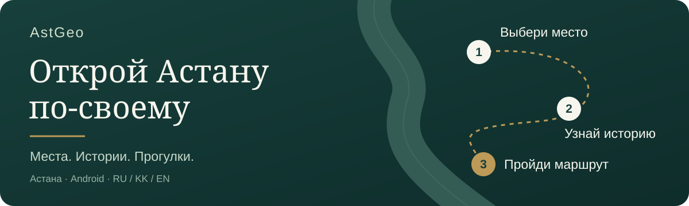

# AstGeo

<p align="center"></p>

<p align="center"><strong>Места, ради которых хочется выйти. Истории, ради которых хочется остаться.</strong></p>

<p align="center">
  <a href="#что-получает-человек">Польза</a> ·
  <a href="#в-чём-особенность-astgeo">Особенность</a> ·
  <a href="#реальные-экраны-приложения">Экраны</a> ·
  <a href="#первая-прогулка">Первая прогулка</a> ·
  <a href="docs/delivery/ASTGEO-0.6.2.md">Версия 0.6.2</a>
</p>

## Куда пойти в Астане сегодня?

**AstGeo помогает превратить свободное время в понятную прогулку по городу.** Открой карту, посмотри фотографии интересных мест, выбери, что тебе близко, и узнай историю за знакомым фасадом. Погода и памятные даты помогают объяснить, почему место стоит внимания именно сейчас.

Для первого знакомства подготовлена прогулка у Байтерека: маршрут, три истории и озвучка на русском, казахском и английском. Всё нужное для этого сценария находится в одном приложении.

<p align="center"><strong>5 мест с фотографиями &nbsp;·&nbsp; 1 подготовленная прогулка &nbsp;·&nbsp; 3 языка</strong></p>

## Что получает человек

| Для кого | Что даёт AstGeo |
|---|---|
| Гость Астаны | Помогает сориентироваться в городе, увидеть районы и выбрать первую прогулку |
| Житель города | Даёт повод посмотреть на знакомые места внимательнее и узнать их истории |
| Человек с ограниченным временем | Показывает заранее подготовленный маршрут с длительностью, остановками и возвращением к старту |
| Любитель прогулок и аудио | Позволяет слушать выбранную историю и продолжать знакомство с местом |

## В чём особенность AstGeo

**Город раскрывается постепенно.** Знакомство начинается с плавного открытия карты и объяснения районов и двух берегов Есиля. Затем человек сам выбирает интересную точку.

**У места есть лицо и причина для визита.** Реальная фотография помогает понять, что тебя ждёт; короткая карточка объясняет ценность места. Погодный контекст и календарь добавляют повод выйти именно сегодня.

**У прогулки есть связная история.** Байтерек, Нуржол и Круглая площадь собраны в один маршрут. Истории можно читать или слушать, а прогресс продолжить позже. Квесты остаются необязательной частью знакомства.

Особенность проекта — это сочетание локального знания об Астане, контекста дня и готового сценария прогулки. Эти части помогают пройти путь от «куда пойти?» до собственного открытия города.

## Реальные экраны приложения

<table>
<tr>
<td align="center"><br><strong>Понятный маршрут</strong><br><sub>Остановки, время и возвращение к старту</sub></td>
<td align="center"><br><strong>Место с историей</strong><br><sub>Фотография и причина присмотреться</sub></td>
<td align="center"><br><strong>Открытия рядом</strong><br><sub>Исторические места Астаны</sub></td>
</tr>
</table>

<sub>Настоящие снимки Android, без перерисовки интерфейса: карта — ранняя сборка 0.2.0; карточки мест — 0.6.0. Они сняты до переименования AstanaAI в AstGeo. Актуальная версия — 0.6.2.</sub>

## Первая прогулка

### «Город между небом и землёй»

**80 минут · около 3,2 км · 3 остановки · старт у Байтерека**

```text
Байтерек → Нуржол → Круглая площадь → возвращение к старту
```

Выбери язык, прочитай или послушай главу и продолжи в удобном темпе. Прочитанные истории сохраняются на телефоне. После последней главы завершение подтверждается отдельной кнопкой. Путь до публичной точки старта не входит в длительность маршрута.

[Подробнее о прогулке и источниках →](docs/FIRST-EDITORIAL-WALK.md)

## Возможности версии 0.6.2

- Большая карта и пять интересных мест: Байтерек, Хан Шатыр, набережная Есиля, музей Сакена Сейфуллина и театр имени Горького.
- Фотографии, исторический и тематические фильтры, карточки с источниками.
- Погодный контекст с отметкой времени, ручной выбор условий и тематические даты Казахстана.
- Интерактивное знакомство с шестью районами в разделе «О городе».
- Одна подготовленная прогулка, истории RU / KK / EN, 54 встроенные аудиозаписи и сохранение чтения.
- Продолжение выбранной аудиоглавы в фоне; GPS не включается автоматически.

У остальных мест есть карточки и переход во внешние карты. Погода и уличная карта требуют сети; истории и подготовленные аудиозаписи входят в приложение. Неизвестные часы работы остаются неизвестными, а праздничная дата не выдаётся за подтверждённое мероприятие.

## Куда проект будет развиваться

Следующие возможности — планы, их ещё нет в текущей версии:

- Больше проверенных маршрутов и персональный подбор по времени, интересам и темпу.
- Фильтры для авторов контента: эстетичные фасады, места для красивых видео и публичные локации, популярные у блогеров.
- Более подробная адаптация прогулки к условиям дня.

Реальные модельные API и генерация историй сейчас выключены. Текущая версия использует подготовленный контент, правила рекомендаций и проверяемые источники. [Фокус первой версии и отложенные функции →](docs/FOCUSED-RELEASE.md)

## Разработчикам

Приложение построено на **React Native / Expo, TypeScript и Kotlin**. Карта — MapLibre / OpenFreeMap с данными OpenStreetMap; прогресс — SQLite. Код публикуется под названием AstGeo, внутренние package ID и имена баз сохранены для совместимости обновлений.

| Где смотреть | Что внутри |
|---|---|
| [apps/mobile](apps/mobile/README.md) | Android-приложение и инструкция сборки |
| [content/first-walk](content/first-walk) | Истории, места и источники |
| [packages](packages) | Контракты прогулки, планировщик и модули данных |
| [Статус](docs/IMPLEMENTATION-STATUS.md) | Фактически выполненные проверки и открытые вопросы |
| [Релиз 0.6.2](docs/delivery/ASTGEO-0.6.2.md) | Точная сборка APK, SHA-256 и результаты на Android |
| [Совместная работа](docs/CONTRIBUTING-WINDOWS.md) | Ветки, проверки и интеграция двух ноутбуков |

APK 0.6.2 для Android ARM64 и презентация проекта подготовлены отдельно. APK использует локальную подпись разработки. Поле, входы и часы, Android 14+, длительная батарея и человеческая вычитка KK/EN остаются отдельными проверками.

### Источники и материалы

[Фотографии и лицензии](apps/mobile/assets/discovery/CREDITS.txt) · [Источники историй](evidence/first-walk/content-source-recheck.md) · [Контекст погоды и дат](docs/research/DISCOVERY-CONTEXT-SOURCES.md)

Код, фотографии, карты и голосовые материалы имеют разные условия использования; общего лицензионного разрешения для всех материалов здесь не заявляется.
