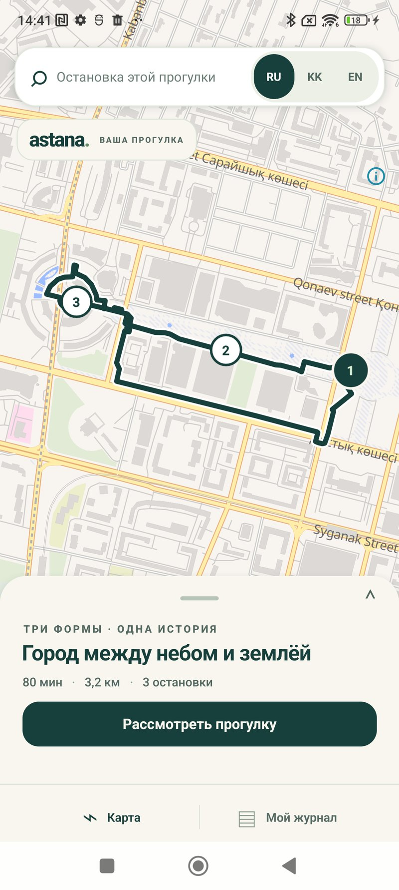
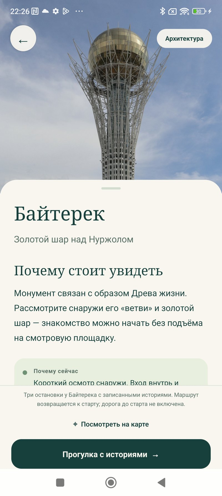

# AstGeo

### Астана раскрывается через места, истории и прогулки

AstGeo — Android-приложение, которое помогает выбрать интересное место в Астане, понять, почему туда стоит пойти сегодня, и пройти одну цельную прогулку с историями и озвучкой.

<p align="center">
  <a href="https://github.com/ersssz/smartcity-ai/tree/codex/astgeo-0.6.2"><strong>Исходный код · 0.6.2</strong></a>
  &nbsp;·&nbsp;
  <a href="docs/FOCUSED-RELEASE.md">Что входит в первую версию</a>
  &nbsp;·&nbsp;
  <a href="docs/delivery/ASTGEO-0.6.2.md">Сборка и результаты проверок</a>
</p>

<p align="center">
  
  
  
</p>

---

## Как это работает

1. Открой карту Астаны и посмотри места с фотографиями.
2. Выбери тему или фильтр и прочитай, почему место подходит для знакомства с городом.
3. Начни подготовленную прогулку у Байтерека: три остановки, истории на русском, казахском или английском, записанная озвучка и возвращение к старту.
4. Продолжи чтение позже: прогресс сохраняется на устройстве.

Рекомендации учитывают текущую городскую погоду и тематические даты календаря. Приложение объясняет контекст совета; неизвестные часы работы не трактуются как подтверждение, что место открыто.

## Экраны приложения

<table>
  <tr>
    <td align="center"><br><sub>Карта и маршрут · Android</sub></td>
    <td align="center"><br><sub>История о Байтереке</sub></td>
    <td align="center"><br><sub>Музей Сакена Сейфуллина</sub></td>
  </tr>
</table>

Снимки сделаны на Android в версиях 0.6.0–0.6.1, до переименования AstanaAI в AstGeo; это настоящие экраны приложения, без перерисовки. Результаты по текущей версии 0.6.2 собраны в [отчёте релиза](docs/delivery/ASTGEO-0.6.2.md).

## Что работает сейчас

| Возможность | Текущее поведение |
|---|---|
| Знакомство с городом | Карта и шесть районов в разделе «О городе» |
| Места | Пять карточек с фотографиями, источниками и тематическими фильтрами |
| Погода и даты | Контекст городского прогноза и календаря с отметкой времени и ручным вариантом |
| Редакционная прогулка | Подготовленный круговой маршрут у Байтерека: 80 минут, 3 остановки, около 3,2 км |
| Истории и звук | RU / KK / EN, 54 встроенные аудиозаписи, сохранение прочитанного |
| Личная геолокация | GPS не запускается автоматически; чтение истории не означает подтверждённое посещение |

Первая версия сосредоточена на открытии мест и одной цельной прогулке. Готовый маршрут от каждой карточки пока не обещается. Генерация историй через модель, публичные профили, коллекции, GPS-награды и расширенные фильтры остаются будущими направлениями. Полный список границ и решений — в [фокусированном плане релиза](docs/FOCUSED-RELEASE.md).

## Загрузки и сборка

APK AstGeo 0.6.2 для Android ARM64 и русская презентация проекта уже подготовлены отдельно. APK подписан локальным ключом разработки и предназначен для установки и проверки; это не публикационная подпись Google Play. Сборка и её SHA-256 описаны в [отчёте релиза](docs/delivery/ASTGEO-0.6.2.md).

Для исходников нужны Node.js и Android-инструменты. Начни с [инструкции мобильного приложения](apps/mobile/README.md). Локальные проверки из корня репозитория запускаются так:

```powershell
.\scripts\verify-local.ps1 -PythonPath 'C:\Path\To\python.exe'
```

Скрипт использует уже установленные зависимости; конкретная среда сборки и фактические результаты описаны в отчётах `docs/delivery/` и `evidence/`.

## Устройство проекта

- `apps/mobile` — приложение React Native / Expo и Android-модуль озвучки и активной прогулки.
- `content/first-walk` — подготовленные истории, места и источники.
- `packages/contracts` и `packages/walk-planner` — модель прогулки и планировщик по сохранённым данным.
- `packages/city-evidence` и `packages/offline-pack` — проверяемые данные мест и локальные пакеты.
- `docs` — продуктовые решения, границы функций и документация релизов.
- `evidence` — результаты проверок; ручные, локальные и статические проверки помечены раздельно.

## Прозрачность и источники

Карта использует OpenStreetMap-данные и OpenFreeMap; фотографии и аудио имеют отдельные источники и условия использования. Смотри [кредиты мобильных фотографий](apps/mobile/assets/discovery/CREDITS.txt), [источники контента прогулки](evidence/first-walk/content-source-recheck.md) и [план проекта](docs/plan/README.md).

AstGeo — развивающийся проект, а не законченный городской справочник. Полевая проверка входов и часов, расширенная проверка Android-версий и человеческая редактура казахской и английской озвучки отмечены как отдельная работа в [статусе реализации](docs/IMPLEMENTATION-STATUS.md).
