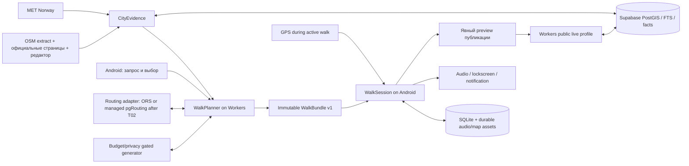

# AstanaAI — архитектура v1

Дата решений: 20 октября 2026. Статус: исполнимая спецификация; приложение ещё не создано, совместимость и полевые результаты ещё не проверены. Продуктовые решения и сроки — в `DECISIONS.md` и `PRODUCT-SPEC.md`; внешние факты и ссылки — в `RESEARCH.md`. При расхождении эти документы согласует главный Codex до изменения общего контракта.

## 1. Решение о стеке и границы выпуска

Выбрана одна кодовая база TypeScript: Android на React Native/Expo, HTTP backend на Cloudflare Workers, PostgreSQL Supabase. Собственный постоянно работающий компьютер, Docker-сервер и платный хостинг для работы беты не требуются. Компьютер разработчика используется для сборки, ingestion и редакционной подготовки.

| Слой | Выбор | Механический fallback |
|---|---|---|
| Android | Expo development build, React Native New Architecture; локальная сборка Android Studio/Gradle на Windows | При несовместимости Expo CNG — тот же React Native с проверенным native Android-проектом и Expo Modules. Если самостоятельный подписанный APK с нужными native-функциями не проходит T01, beta gate закрыт; работа над данными/backend продолжается |
| Карта | MapLibre React Native + OpenFreeMap Liberty, native offline packs | Тонкий native adapter для контроля UA/параллельности/байтов. Если соблюдение условий offline-download не доказано, готовность offline-карты не объявляется и beta gate закрыт |
| Прогресс | `expo-sqlite`, транзакции, журнал событий, версионированные миграции | Тот же SQLite через native adapter, если Expo wrapper мешает необходимому поведению; интерфейс WalkSession сохраняется |
| Звук | Подготовленные файлы глав RU/KK/EN + `expo-audio`; системный Android TTS для новых коротких фраз | Если системного kk-голоса нет, обязательные главы, задания и команды имеют заранее записанные файлы с подтверждёнными правами. Новая персональная реплика остаётся текстом с честным состоянием озвучки. Отсутствие обязательного core audio на любом языке блокирует бету |
| Backend | Workers Free, Hono, Zod; HTTP/PostgREST через `supabase-js`; SQL RPC | При превышении CPU — перенос вычисления в SQL, ограничение кандидатов и размера ответа. Не переносить тяжёлый routing/ingestion в Worker. Если пределы всё равно нарушаются, отключить новые запросы, продолжить сохранённые прогулки |
| БД | Supabase Free: PostGIS, FTS + `pg_trgm`; pgvector только после отдельного измерения | Первоначально lexical + tags + multilingual aliases; embeddings не являются обязательным платным условием RAG. При pause/недоступности БД server planning недоступен, локальные сессии работают |
| Пеший путь | ORS `foot-walking` — первый проверяемый hosted adapter; arbitrary GPS start/end включаются только после отдельного lawful-routing и endpoint-geometry PASS в T02 | Если передача исходных координат не допустима/не выяснена, T02 проверяет managed pgRouting SQL RPC на собственном OSM foot graph в той же Supabase. Если этот adapter также не проходит topology/resource/endpoint tests, только явный выбор доступного публичного старта или noFeasible; обязательный current-start gate M2-TECH остаётся FAIL. Публичный demo router, прямые connector и ноутбук сервера не являются fallback |
| Погода | MET Norway Locationforecast 2.0 `compact`, серверный кеш | Последний снимок до 6 часов — только как устаревший прогноз; старше/нет снимка — unknown и исключение обещаний, зависящих от погоды. Для сценария «замёрз, хочу внутрь» требуется подтверждённое доступное помещение независимо от прогноза |
| Generation | Gemini Developer API `gemini-3.5-flash-lite`, только после бесплатного quota/privacy gate | `gemini-3.1-flash-lite` при недоступности/нулевой квоте первого; затем доступная модель OpenAI API, выбранная по конкретному аккаунту после models/access/cost/quality gate T02 и только при подтверждённых уже имеющихся разрешённых кредитах. Точный API model ID фиксируется результатом T02; список моделей Codex не доказывает API entitlement. Локальный inference допустим только после доказательства качества/доступности на устройстве пользователя; notebook server не засчитывается. Если ни один adapter не проходит, RAG beta gate закрыт |
| Публичный профиль | Небольшая HTML/JS страница на Workers Static Assets, динамический read endpoint и Supabase snapshot | При недоступности backend показывать недоступность. Не выдавать stale CDN-копию отозванного/истёкшего профиля |

Проверенные на дату **кандидаты**, а не доказанная сборка: Node 22.22.2 уже обнаружен; Expo 58.0.16, официальный template 58.0.25 с React 19.3.0/RN 0.88.0, MapLibre RN 11.5.0, SQLite 58.0.13, Audio 58.0.9, Location 58.0.18, TaskManager 58.0.12, SecureStore 58.0.2; Supabase JS 2.118.0, Hono 4.13.13, Zod 4.6.7. Root фиксирует точный lockfile после T01/T03; обновление пакета повторяет затронутые native gates. Не устанавливать независимо последние версии React/RN поверх Expo template.

Выпуск v1 — ограниченная взрослая закрытая Android-бета; размер продуктового пилота задан только в PRODUCT-SPEC, технический ceiling ёмкости — 20 установок. Базовый городской каталог и guided walks в глубоких зонах различаются по полноте. M2-TECH допускает явно маркированную исследовательскую сборку до полевого пилота; FIELD-PASS нужен до обещания проверенного сопровождения по районам. Квесты, коллекции и три языка обязательны. У Google Free есть отдельное ограничение аудитории и данных; широкая будущая аудитория продукта не означает автоматического права использовать этот adapter для несовершеннолетних. Сроки — оценки из DECISIONS, не обещание по результатам этой спецификации.

## 2. Три глубоких модуля

Module имеет маленький Interface и скрывает изменяемую Implementation. Seam проходит по контракту и проверяется теми же вызовами, которыми пользуется приложение. Отдельные микросервисы этим трём Module не нужны.



| Module | Interface | Depth / Implementation |
|---|---|---|
| CityEvidence | `search(EvidenceQuery): EvidenceSet` | Источники, ingestion, нормализация RU/KK/EN имён, дубли, spatial/lexical поиск, датированные факты, доступность входов, расписания и weather snapshot |
| WalkPlanner | `plan(PlanRequest): PlanReply`; `revise(RevisionRequest): PlanReply` | Интерпретация ограничений, retrieval, реальные foot legs, расписания по ETA, ранжирование, generation по fact IDs, проверка ответа, версия bundle |
| WalkSession | `open(bundleOrSessionId)`, `dispatch(command)`, `snapshot()` | Атомарный local progress, GPS quality, прибытия, задания, коллекции, foreground lifecycle, загрузка ресурсов, audio, восстановление |

Provider adapters приватны внутри этих Module: `Routing`, `Weather`, `Generator`, `EvidenceStore`, `SessionStore`, `Audio`, `MapPack`, `Location`. Реальный adapter и deterministic replay adapter для contract-тестов дают рабочие seams. Передача provider-specific ответов в UI запрещена контрактом. Публикация — вспомогательный adapter экспорта разрешённых достижений, не четвёртая распределённая платформа аккаунтов.

Первый сквозной путь: 80 минут, необычное и кофе, возврат к старту → 1–3 выполнимых прогулки → запуск → глава и задание → «замёрз, хочу внутрь» → подтверждение выполнимой замены → offline → перезапуск → итог/коллекция. Полевое доказательство отделено от replay тестов.

## 3. Контракты и инварианты

Человекочитаемые определения закрепляются в `GLOSSARY.md`. Источник машинной схемы при реализации — один пакет contracts, принадлежащий Root; Zod schemas выводят TypeScript-типы и JSON-schema. Примеры ниже — обязательная семантика, не уже написанный код.

```typescript
type Locale = 'ru' | 'kk' | 'en';
type Endpoint = { kind: 'point'; lng: number; lat: number;
  source: 'gps' | 'manual'; accuracyM?: number; capturedAt?: string } |
  { kind: 'public_anchor'; anchorId: string; explicitlyChosen: true };
type EndRule = { kind: 'return_to_start' } |
  { kind: 'last_stop' } | { kind: 'point'; endpoint: Endpoint };
type PlanReply =
  | { kind: 'candidates'; bundles: WalkBundleV1[] } // 1..3
  | { kind: 'clarification'; fields: string[]; message: string }
  | { kind: 'no_feasible_walk'; reasons: Reason[] }
  | { kind: 'unavailable'; code: DependencyError; retryAfterSec?: number };
type DependencyError = 'DATA_UNAVAILABLE' | 'ROUTING_UNAVAILABLE' |
  'GENERATION_UNAVAILABLE' | 'BUDGET_EXHAUSTED';
```

`PlanRequest`: `requestId`, `locale`, `origin:Endpoint`, `startAt` (ISO instant), `budgetMinutes` (15–240), `endRule` (явно default return-to-start), `interests[]`, нормализованные `constraints`, `contextFlags`. Исходный GPS/manual origin не меняется на ближайший POI. Для возврата сохраняется тот же исходный endpoint; текущая позиция во время адаптации не заменяет его. У явно заданного конца сохраняется выбранный endpoint. У `last_stop` сохраняется семантика «последняя остановка»: после изменения состава/порядка её endpoint вычисляется заново, координата прежней последней остановки не фиксируется как скрытый обязательный конец. Exact point может передаваться только собственному планировщику в request memory по HTTPS, без сохранения в server cache/logs/analytics. Внешнему генератору передаются whitelist нормализованных preferences и общественные факты; исходный свободный текст, GPS, псевдоним, capability token и история перемещений остаются вне prompt. Неподдержанное условие требует пояснения. Публичные anchors разрешаются сервером. Выбор такой точки вместо текущей возможен только явным UI действием и не является уже рассчитанным подходом к ней.

| WalkBundle v1 | Содержание |
|---|---|
| Идентичность | `schemaVersion:1`, `bundleId`, `revision`, `parentRevision?`, `generatedAt`, `contentRevision`, `evidenceRevision`, `plannerVersion`; SHA-256 канонического payload |
| Исходные условия | `requestId`, исходный `origin:Endpoint`, `endRule` и вычисленный для этой revision `resolvedEnd` (у last_stop — последний stop ID/endpoint), `startAt`, `timeZone:'Asia/Almaty'`, `budgetMinutes`, нормализованные constraints; точные endpoints остаются в локально сохранённом bundle, не в публичном профиле/server history; timestamps UTC |
| Временной план | `walkMinutes`, `visitMinutes`, `reserveMinutes`, `totalMinutes`, `arrival/departure` каждой остановки; посещение помещается в подтверждённый интервал, не только момент прибытия |
| Остановки | Стабильный `stopId`, `poiId`, порядок, общественная outdoor arrival anchor, тип доступа/ограничения, `factRefs`, источник/дата/validUntil, известное и unknown; ID главы/квеста/коллекции |
| Путь | GeoJSON LineString для каждого foot leg, расстояние/ETA, route source/version/date/license; отдельно `requestedEndpoint`, `matchedGraphPoint`, `snapDistanceM`, качество привязки и подтверждённый connector geometry/time. От origin до первой остановки и от последней до выбранного end включено всё время. Missing connector не заменяется прямой линией; такой план не получает feasible |
| Содержание | RU/KK/EN editorial chapter, краткое действие, разметка fact/idea/fiction, quest rule и допустимое доказательство выполнения, ссылки на факты; сгенерированные объяснения с поддерживающими fact IDs |
| Ресурсы | Content-addressed audio refs/checksums/license по языкам; map pack bounds/zoom/style/license/estimate; `requiresNetwork` и ожидаемая версия assets. Готовность фактических скачиваний хранится локально, не заявляется сервером |
| Контекст | Weather forecast model/update/retrieved time, состояние свежести, сезон, датированный календарь праздников и исключения расписаний; предупреждения и атрибуция |

Bundle не содержит progress, capability tokens, GPS-трек и данных другого пользователя. Он может содержать необходимый исходный/конечный endpoint только для локального продолжения выбранной прогулки. Plan responses — `Cache-Control:no-store`; generic server bundle history и cache точных endpoints отсутствуют. Сервер ограничивает JSON bundle 512 KiB; объём медиаресурсов отделён от JSON. Формат координат GeoJSON — `[longitude, latitude]`, расстояния — метры, время — минуты/UTC timestamps; origin не считается остановкой без отдельного stop ID.

Инварианты WalkPlanner:

- Только реальные `poiId`/`factId`; генератор выбирает/объясняет, валидатор проверяет существование и поддержку утверждений. Внешний текст источника обрабатывается как данные.
- `total = foot legs + visits + reserve <= budget`; формула начального резерва и порог существенного удлинения находятся только в PRODUCT-SPEC, разделе «Планирование и согласие на изменения». Backend рассчитывает по ним значения bundle; мобильный клиент их не пересчитывает другой формулой. Краткий бюджет может дать пустой результат. Скорость/ETA адаптируются к выбранным ограничениям, не обещают медицинскую или универсальную доступность.
- Критическое unknown (закрытый вход, неизвестный режим обязательного indoor-места, неподтверждённая доступность) исключает это обещание; берётся подтверждённая альтернатива или none-feasible.
- Расписания хранятся структурированно: weekly intervals + датированные exceptions + timezone + provenance. Неразобранная OSM `opening_hours` остаётся raw/unknown. Праздник не означает автоматически закрытие; override должен иметь источник. Интервалы через полночь проверяются по календарным датам.
- Маршрутизация — по foot graph. Геометрический радиус применяется для первичного отбора, затем проверяются реальные переходы, входы, водные/дорожные барьеры и выбранный end rule.
- Online revise получает оставшийся бюджет, completed stop IDs, текущий `from:Endpoint` и исходный end rule: original origin для return-to-start, выбранный endpoint для explicit end, либо last_stop с новым resolved last stop после согласованной замены. Исправление перехода при отклонении выполняется автоматически, если сохраняет остановки, тему, end rule и укладывается в пороги PRODUCT-SPEC; записывается новая bundle revision и понятное уведомление. При замене остановок/темы, существенном удлинении или выходе за конец сначала показывает предложение/diff, принимаемое только явной командой. Отказ оставляет прежний согласованный план, не скрывает фактическое отклонение. Выполненные достижения сохраняются.

### Точный origin, connector и routing gate T02

1. Android берёт current GPS с accuracy/time либо пользовательскую точку. WalkPlanner удерживает этот `requestedOrigin` неизменным; для return-to-start `requestedEnd=requestedOrigin`. Если точность недостаточна для сопоставления пешей стороне дороги, возвращает clarification, а не уверенную привязку через барьер.
2. ORS candidate adapter включается для exact coordinates только когда T02 документировал допустимость такого использования условий провайдера, обработку/retention координат, нужное уведомление пользователю и сетевой trace без identifier/track. До этого ORS получает только публичные anchors. Это консервативное проектное ограничение, **не юридический вывод, что любые lat/lng запрещены**.
3. Если lawful exact-origin ORS не прошёл, fallback — graph в managed Supabase: локальный ingestion строит `walk_vertices/walk_edges` из OSM узлов/ways, foot/access restrictions, crossing/barrier/bridge/tunnel levels; искусственные junctions в местах простого 2D-пересечения не добавляются. pgRouting pathfinding и PostGIS linear referencing выполняются внутри параметризованного SQL RPC. Точки начала/конца временно привязываются к подходящим edge/fraction; возвращаются ordered edge geometry, distance и cost по пешей скорости. Наличие extension подтверждено документацией, наличие корректного графа в нашем проекте — ещё нет.
4. **Connector тоже требует данных.** От requested point к matched graph point берётся только существующий путь из графа/разрешённого walkable-area сегмента или заранее проверенный редактором public access connector с provenance. Его geometry и время добавляются в первый/последний leg и бюджет. Наличие ближайшего node/edge, `ST_ClosestPoint`, малое расстояние или центр POI сами по себе connector не подтверждают. Неизвестный разрыв, закрытый двор/вход, несвязные компоненты дают `clarification:choose_start`/`no_feasible_walk`, не прямой passage.
5. Явный выбор публичного стартового anchor допустим отдельным действием. Если обещается прогулка от текущего положения, подход **и возврат к исходному положению** должны быть рассчитаны/включены тем же способом. Если подход не подтверждён, приложение честно меняет выбранный старт на публичную точку по согласию и показывает, что время до неё не рассчитано; это другой запрос, не выполнение 80-минутного current-origin сценария.
6. T02 exact-origin PASS требует baseline 10 foot pairs/одного района по tracker, включая текущий origin, first/last connector, return-to-same-origin, разные стороны барьера, вход, невозможное сопоставление и согласие на другой старт. Для managed graph: DB total <=400 MB из free 500 MB (граф+индексы <=300 MB), p95 SQL leg <=2 s, SQL timeout 3 s, request memory/endpoint parameters не логируются. При fail оптимизировать один раз/сузить проверенную область; затем current-origin gate M2-TECH блокируется. Более широкая coverage/field проверка — T17 и EXECUTION, не выдуманное доказательство T02.

Версионирование: новый optional field допустим в v1, новое обязательное поле/смысл существующего — v2. Читатель v1 отклоняет неизвестный major понятным `UNSUPPORTED_BUNDLE_VERSION`; известные сохранённые v1 продолжаются. Bundle revision не заменяет SQLite schema version. Миграция БД транзакционная с проверкой восстановления предыдущей версии при ошибке; скачанные материалы активной сессии удерживаются до её завершения.

## 4. WalkSession: offline, GPS и звук

Локальные состояния: `prepared → active ↔ paused → completed | abandoned`. `interrupted` восстанавливается из journal; автоматическое продолжение tracking после явной force-stop не обещается. Одновременно одна active session. `offlineReady` — отдельное свойство готовности материалов, а не состояние прохождения.

Каждая команда имеет уникальный `eventId`. Одна SQLite transaction записывает событие, новый snapshot, изменения quests/collections и outbox уведомления. Уникальность `sessionId+eventId`, `sessionId+questId+awardKind`, глобальное `poiId+first_app_confirmed_nearby` исключает повторные награды. Восстановление повторяет недоставленный outbox; notification IDs стабильны. Сессия принадлежит установке; публичный профиль не восстанавливает её.

`prepare` проверяет checksum bundle, три языка, все обязательные главы/задания, аудио и разрешённую область карты; загружает через временные файлы и атомарно активирует manifest. Файлы активной прогулки лежат в durable app storage, не в удаляемом системном cache. До завершения проверки UI показывает точные отсутствующие части. Online-старт с неполным pack возможен после предупреждения; обещание «всё готово без сети» доступно только при `offlineReady=true`. При необходимости освободить место сначала удаляются старые неактивные packs, с подтверждением пользователя; progress не удаляется вместе с map/audio.

`offlineReady` принадлежит тройке `(bundleHash, revision, assetManifestHash)`. Принятие любой новой revision инвалидирует прежний ready и запускает проверку ресурсов новой версии; общие совпадающие assets переиспользуются по checksum. Старый pack не удаляется до успешной подготовки нового. Обрыв скачивания после адаптации показывает `partial` и недостающие map/audio/chapters, не наследует старый ready. Старый план остаётся доступным как предыдущий и не маскируется под новую принятую revision; пользователь может явно вернуться к нему, если он всё ещё выполним.

Offline доступны сохранённые foot geometry, ограниченная подложка карты, остановки, главы, задания, записанная озвучка и SQLite progress. Вне скачанной области остаётся сохранённая линия и список шагов с явной границей карты. **Нового пешего маршрута и offline reroute в v1 нет.** При отклонении показываются сохранённый путь, потеря актуального сопровождения и возможность вернуться/прервать; стрелка по прямой не маскируется под безопасный пеший путь. Новый план/AI-ответ ждут сети. Weather/opening snapshot показывают возраст, не обновляются выдуманно.

Для OpenFreeMap pack ограничить одновременно обоими потолками: <=3000 tiles и <=50 MB скачанных ресурсов, <=4 in-flight запроса, постоянный идентифицирующий User-Agent. Preflight по bounds/zoom, byte counter и cancellation enforced native networking adapter; `setTileCountLimit` сам по себе не доказывает byte/concurrency compliance. В T01/T10 проверить сетевым trace. Если лимит превышается — сначала сузить зум/область вокруг данной прогулки, затем показать меньшую область; молча раздроблять скачивание ради обхода условий нельзя. Offline атрибуция хранится в bundle.

GPS включается после команды Start из видимого приложения и выключается при pause/end/permission loss. Android foreground service `location`, persistent notification со Stop; media playback настроен отдельно. Expo adapter может требовать более широкое background разрешение: сначала проверяется native foreground-only вариант активной сессии; решение фиксируется T01, без tracking вне активной прогулки. При отказе остаются manual start/manual progress.

Pilot arrival policy из DECISIONS: radius 60 m, reported accuracy <=30 m, dwell >=30 s, минимум 3 правдоподобных отсчёта. Отбрасывать sample старше 15 s, скачки/скорость >3 m/s при пешей сессии; проверять monotonic elapsed time. Эти числа — начальные настройки для T01/T07, **не доказанная полем точность**. Во время poor accuracy или неполного dwell автоматическое прибытие не фиксируется.

`gps_nearby` означает первое подтверждённое приложением приближение к наружному общественному anchor. Оно автоматически даёт соответствующее уведомление для исторического места; не доказывает вход, билет, нахождение внутри музея или присутствие в недоступной зоне. `manual_reported` и `quest_completed` — отдельные источники достижения и подписи в коллекции/экспорте. Ручная отметка не превращается в GPS-подтверждение. Высокоценные награды/античит не входят в обещание этой capability-беты.

Звук: основная редакционная глава и задания всегда имеют подготовленные RU/KK/EN файлы с rights manifest. Android TTS для динамических реплик проверяет язык/engine при запуске, синтез в файл реализуется тонким Expo native module; затем один Audio adapter воспроизводит и готовые, и локально синтезированные файлы. Expo Speech не считается доказательством file synthesis/фонового playback. On-device voice licensing разрешает локальное использование только после проверки конкретного движка; автоматически публиковать его файлы на сервер нельзя. При отсутствии голоса записанный core audio остаётся доступным. Headphones disconnect приостанавливает звук; lockscreen pause/resume проверяются отдельно. Микрофон/RECORD_AUDIO не нужны, запись отключена в native manifest.

## 5. Серверные данные, RAG и запросы

CityEvidence получает OSM через скачиваемый Geofabrik Kazakhstan extract: локальный воспроизводимый CLI отбирает Astana bbox/категории, нормализует и deduplicates по стабильным OSM IDs и близости. Raw snapshot/hash/date сохраняются вне мобильного пакета; cloud DB получает только очищенный выбранный набор. Дополнительные часы/входы/факты — с официальных страниц учреждений и ручной редакционной верификацией, с датой и правом хранения. Сбор не использует public Nominatim для bulk и не превращает Google Maps/2GIS описания в свободную БД.

Данные: `poi`, `public_walk_anchors`, `facts`, `hours_intervals`, `hours_exceptions`, `content_revisions`, `chapters`, `quests`, `collections`, `route_cache`, `weather_cache`, `public_profiles`, `budget_reservations`; при managed graph adapter — `walk_vertices`, `walk_edges`, `access_connectors`. OSM-derived dataset и авторские главы отделены и имеют собственные license refs. Таблиц аккаунтов, e-mail, exact request endpoints и backend GPS tracks нет. Raw source HTML не попадает в prompt; prompt содержит отобранные факты.

Workers вызывает parameterized SQL RPC через HTTPS/PostgREST. Geo/mandatory filters применяются **внутри** search RPC до ranking/limit; lexical поиск объединяет RU stemming и `simple`/aliases для KK/EN; weighted tags/trigram поддерживают короткие имена. `pgvector` может добавить RRF semantic adapter после сравнения на evaluation set, без изменения EvidenceSet/WalkBundle. Настоящий runtime generator обязателен: lexical retrieval + grounded generation уже RAG; выдача подготовленного текста при недоступной модели явно называется сохранённым материалом и не засчитывается как RAG.

Workers сначала вычисляет проверяемый feasible itinerary, затем generator получает public facts и нормализованные prefs для explanations/story framing. Ответ генератора проходит JSON-schema + factRef/POI/constraint validation; семантическое соответствие утверждений фактам дополнительно проверяется evaluation, существующий fact ID сам по себе не доказывает entailment. Максимум 3 сформированных маршрута, 24 retrieval candidates, 6 посещаемых остановок. Матрица public кандидатов — cached distances для prelim selection; финальные foot legs подтверждаются graph response. Один ORS multi-waypoint request подтверждает полный вариант, максимум 3 варианта параллельно (concurrency<=3); SQL graph requests также bounded<=3. Никаких скрытых Web/Search/Maps grounding tool calls.

Внешние HTTP seam:

| Endpoint | Поведение |
|---|---|
| `POST /v1/plans` | PlanRequest → PlanReply; `Idempotency-Key`; request body <=16 KiB |
| `POST /v1/plans/revisions` | Parent bundle hash/revision, completed IDs, remaining minutes, changed constraints, current `from:Endpoint`, original origin/end rule → новая revision с пересчитанным resolved end или предложение адаптации по правилам согласия |
| `GET /v1/content/:revision` | Immutable публичный manifest/chapters/assets metadata с checksum/attribution; conditional GET/cache по revision |
| `POST /v1/public-profiles` | Только opt-in sanitized snapshot; возвращает read URL и отдельный admin capability; идемпотентность публикации |
| `PUT /v1/public-profiles/:id` | Admin bearer + ожидаемая revision; атомарно обновляет выбранные данные и TTL |
| `DELETE /v1/public-profiles/:id` | Admin bearer; немедленный revoke для будущих reads |
| `POST /v1/public-profiles/:id/rotate` | Admin bearer; отзывает старый read token, выдаёт новый URL, snapshot сохраняется |
| `GET /v1/public-profiles/:readToken` | Read-time проверка active/revoked/expiry; `Cache-Control: no-store`, `Referrer-Policy: no-referrer`, `X-Robots-Tag: noindex` |

Domain clarification/no-feasible возвращаются HTTP 200 с discriminant; bad input 400, слишком большой запрос 413, конфликты revision/version 409, quota/rate 429 + Retry-After, dependency unavailable 503; expired/revoked read URL 410 без payload. Сообщения локализованы, provider traces/keys клиенту не раскрываются. Idempotency plan receipt на 15 минут хранит только requestId/status/reservation, без body/GPS/result bundle: повтор после потери уже отправленного ответа получает 409 `RESULT_NOT_RETAINED`; UI предлагает осознанный новый запрос, скрытого повторного расхода нет. Public mutation receipts — 24 часа.

Цель PRODUCT-SPEC для **полных вариантов end-to-end** — p95<=15 s; отдельно hard request deadline=25 s, он не заменяет эту цель. Пределы фаз: evidence SQL и weather параллельно (<=3 s и <=4 s); полный routing <=8 s wall-clock вместе с retries; generation+JSON correction вместе <=10 s; 3 s оставлены на validation/serialization. Для достижения SLO обычный путь должен расходовать меньше hard phase limits; T02/T17 измеряют оба времени, а не только генератор. ORS/SQL concurrency<=3, максимум 6 routing calls **вместе с retries**, новый вызов запускается только если remaining deadline позволяет timeout. При cold cache без матрицы сужается число кандидатов до подтверждаемых в этом бюджете; missing route не синтезируется. Retry максимум один на transient 429/5xx с jitter и `min(providerTimeout, phaseRemaining)`; исчерпание deadline — `*_UNAVAILABLE`/503 с UI retry, а не `no_feasible_walk` (последнее означает доказанную невыполнимость). Paid fallback автоматически не запускается. Дополнительная цель p95 generation<=10 s не засчитывается вместо end-to-end p95<=15 s. При fail оптимизируется/меняется adapter в рамках gate либо readiness не объявляется.

## 6. Публичная коллекция и приватность

Это live profile по постоянной непредсказуемой ссылке, выключенный по умолчанию. Preview содержит выбранный псевдоним, badge IDs, discovery IDs, provenance каждой отметки и выбранные названия завершённых квестов. GPS, трек, точные даты/время посещений, active session, свободный личный текст и device identifiers не экспортируются. В v1 нет загрузки произвольных фото/HTML.

Public payload хранится в PostgreSQL отдельно от локального прогресса. Read и admin capability — независимые случайные 256-bit значения; сервер хранит SHA-256 digests. Admin token живёт только в Android Keystore через SecureStore и передаётся в Authorization, read token — часть share URL. Token не включается в analytics/logs/referrer. Поле `id` не является правом управления. Update/revoke/rotate — один SQL transaction с compare-and-swap revision; хранить payload <=32 KiB. Подделка собственных manual достижений не выдаётся за серверное доказательство присутствия.

`expiresAt = lastExplicitPublishOrUpdate + 30 days`. Просмотр ссылки, обычное завершение прогулки и фоновый sync **не продлевают** срок. Обновление предлагается пользователю и выполняется после явного publish/update. Read endpoint проверяет expiry/revoke при каждом запросе и немедленно закрывает чтение; активный payload удаляется maintenance в пределах 24 часов. Cache запрещён на API/HTML с профильными данными; уже увиденные копии/скриншоты отозвать невозможно. Retention резервных копий провайдера описывается отдельно; мгновенное физическое стирание всех копий не обещается.

Обычный explicit update/renew, включая возобновление после обычного expiry, сохраняет read URL, если он не был отозван/ротирован и не было аварийного restore. После cleanup сохраняется только минимальная capability/expiry metadata без публичного payload; новый payload приходит из выбранного локального snapshot. Отозванный read token не активируется повторно: после revoke создаётся новая публикация с новым read token; rotate тоже меняет URL. Каждый public row имеет `publicationEpoch`, а Worker — отдельный активный epoch вне восстанавливаемого DB snapshot. При любом DB restore сначала отключаются public reads, затем меняется активный epoch, прежние URLs остаются 410; пользователю нужно явное новое publish с новым URL. Возврат старого backup не возрождает revoked/expired link. T13/T21 проверяют rollback/restore; открыть reads до выполнения fail-closed runbook нельзя. Старое изображение публичного профиля у посетителя не считается управляемой серверной копией.

Потеря телефона/admin token означает отсутствие восстановления управления; истечение 30 дней закрывает ссылку. Без аккаунта не добавлять recovery по псевдониму, read URL или обращению к оператору. Локальные данные также не восстанавливаются. Android backup/extraction rules явно исключают progress и admin capability, отдельно проверяется cloud и device-to-device поведение.

Raw GPS хранится на устройстве в памяти для короткого окна фильтрации и не пишется в cloud logs. SQLite хранит origin/end выбранного bundle, stop/provenance и события прогресса, не историю координат. Для debug trace нужен отдельный явный opt-in, local-only экспорт и очистка после разбора. Planner может получить current origin/end в request memory; их не сохраняют SQL tables, query/error/body logs и generic caches. MET получает zone centroid; ORS получает только public anchors, пока T02 lawful exact-origin gate не прошёл; managed graph обрабатывает endpoints внутри собственного параметризованного RPC без retention. Generator получает public facts и whitelist preferences. Это уменьшение данных, не заявление об абсолютной анонимности по всем побочным каналам.

Production secrets (ORS, generator, Supabase server credential, signing material) находятся на сервере/локальном защищённом signing storage. В APK только HTTPS base URLs и публичные style URLs. Supabase server/secret/service-role key не попадает в mobile. Если когда-либо нужен публичный mobile key стороннего SDK, он ограничивается package/signing SHA и конкретным API; наличие ограничений проверяется gate. Worker raw request/error body logging выключен; server RPC grants ограничены необходимыми операциями.

## 7. Эксплуатация при $0

Free tiers дают лимиты, а не SLA. Worker обрабатывает новые планы и публичный профиль; SQLite независимо продолжает активную прогулку. Supabase может приостановить низкоактивный free project. Не обходить pause фиктивным пользовательским traffic. Ежедневная операторская проверка во время тестовой кампании и перед демо, runbook resume/backup/restore; outage отображается честно. Сама проверка не объявляется основанием отмены provider pause.

Начальные внутренние потолки: 20 тестеров, <=50 новых plan/revise operations/day, <=5/device/day; ORS <=300 calls/day и <=20/min; общая live-система останавливает новые генерации при достижении 80% фактической подтверждённой provider quota. Device ID — удобство ограничения, не security boundary; глобальный atomic budget в SQL сдерживает abuse независимо от spoofing. Публикации: <=10 mutations/device/day, <=1/s/token; чтения защищаются aggregate rate limit и maximum payload. Лимиты могут снижаться автоматически по фактической квоте, повышение — отдельное решение после отчёта.

`PAID_CALLS_ENABLED=false` до подтверждённого доступного баланса, срока кредитов, отключённого autopurchase и одобренной суммы из уже имеющегося ресурса. Наличие key не проходит этот gate. Платный adapter допускает только заранее зарезервированную верхнюю стоимость с запасом 20%, ограниченные input/output tokens и concurrency=1; при неизвестной цене/остатке gate закрыт. Даже provider hard limit имеет задержку; strict $0 новых покупок обеспечивается отсутствием новых платных обязательств и default-off, а не надеждой на dashboard alert. При free quota=0 использовать следующий разрешённый бесплатный adapter; free-to-paid switch автоматически не выполняется.

MET кешируется по нескольким public zone centroids, соблюдая Expires/Last-Modified; обновляется при foreground запросе, не на каждом GPS sample. Route cache хранит только public anchor legs: key anchors+profile+avoidance+dataset version, freshness 7 дней; exact origin/end legs возвращаются в request memory и локальный bundle без server cache. Оперативная редакционная блокировка проблемного leg немедленна. Расписания обязательных indoor stops recheck <=7 дней до тестовой кампании; emergency closure flag имеет приоритет. Public expiry/revoke не кешируется. Content/audio immutable assets в APK для первого набора снижают egress; обновления отдельно версионированы.

Наблюдаемые **целевые**, ещё не измеренные SLO для беты: >=99% crash-free sessions; нулевая потеря подтверждённых local progress transitions и нулевые повторные награды; >=95% admitted plan requests успешны при доступных dependencies, end-to-end p95 полных вариантов<=15 s по PRODUCT-SPEC, hard timeout=25 s отдельно; zero известные вымышленные POI/критические нарушения времени; zero утечек секретов и публичных координат. За 7 дней: crash rate >1%, planning failure >5% или p95>15 s — остановить приглашения/новые функции и исправлять. Любая потеря progress, секрет, открытый revoked profile или критически неверный foot path — немедленно выключить затронутую функцию. Нет гарантии provider uptime; dependency failure показан отдельно, а общее пользовательское время/ошибки не скрываются исключением provider failures из отчёта.

Backend snapshots: перед каждой миграцией и ежедневно в активной кампании шифрованный локальный export DB/content; это операционный backup публичных данных, не recovery пользовательского progress/admin token. Проверить restore на отдельной локальной БД до релиза. Бинарный подписанный APK и content revision откатываются вместе; SQLite миграции должны сохранять уже существующие v1 sessions. APK обновляется тем же applicationId/signing key; ключ не коммитится. Отдельно дать оператору защищённую резервную копию signing key; его потеря не компенсируется профилем пользователя.

## 8. Gates, доказательства и параллельная работа

| Gate | Условие pass | При fail |
|---|---|---|
| NATIVE / T01 | На Windows воспроизводимы dev APK и подписанный standalone APK; карта+SQLite+audio+GPS together, установка/upgrade без Metro | До 2 рабочих дней устранения совместимости; native adapters/обычный RN Android в той же архитектуре; иначе stop mobile beta gate, без обещания PWA вместо locked-screen функции |
| DATA-ROUTING / T02 | Baseline tracker: 10 foot pairs, один район и 15–20 POI; actual origin/end geometry+lawful exact-coordinate adapter проходят описанный выше gate; quotas/licenses подтверждены. Расширение районов/полевое доказательство — T17 | Public anchor выбор возможен явно; неразрешённый current-origin сценарий оставляет M2-TECH blocked. Replay не заменяет поле |
| RAG / T02 | Подтверждены free tier/credits и policy; 30 запросов (10/язык) на реальных retrieved facts, 0 invented POI/critical unsupported facts, >=90% valid supported answers, p95 generation<=10 s | Следующий разрешённый adapter в том же Generator seam; затем stop RAG beta gate, независимые задачи продолжаются |
| LOCATION-AUDIO / T01/T07 | Матрица физических Android/locked screen/network/interruption из EXECUTION; real/replay GPS mode явно указан. Логика никогда не утверждает museum-entry, stop выключает location; RU/KK/EN core audio online/offline. Полевые метрики arrival — отдельно | Калибровка arrival; ручные отметки остаются отдельно. Если native locked-screen сопровождение не работает, M2-TECH gate закрыт; replay не даёт полевой аттестации |
| OFFLINE / T10 | Полный pack с картой/audio; adapt→new revision→network loss не наследует ready; соблюдены limits/UA/concurrency; restart/reboot/process kill восстанавливают progress; никаких duplicated awards | Исправить native/cache/transaction implementation; срезать область карты до подходящей прогулке. Урезание языков/квестов не считается pass |
| PROFILE / T13/T21 | Opt-in preview; update/rotate/revoke; read-time expiry; cleanup <=24 h; 0 GPS/date/admin token в public payload/logs; restore не возрождает старый URL | Public publishing выключен до исправления; полная beta не принята |
| RELEASE | Все минимальные главы/квесты/коллекции из PRODUCT-SPEC, три языка и grants/rights; backend restore/APK upgrade испытаны; runbook/limits/evidence доступны | Откладывается beta readiness, а не подмена доказательств красивым демо |
| FIELD-PASS / T17 | Только полевые объём и критерии EXECUTION/PRODUCT-SPEC: маршрут каждой глубокой зоны и key scenario на втором устройстве, живые входы/переходы/GPS/батарея с отчётом | До pass сборка остаётся маркированной закрытой исследовательской бетой; обещание проверенного городского сопровождения не публикуется |

Имена выше — локальные архитектурные проверки; они не переопределяют G0–G4 процесса из TEAM-WORKFLOW/EXECUTION. При расхождении конкретного task ID/объёма источник — tracker; здесь записано назначение проверки.

Root владеет общими contracts, зависимостями, lockfile, миграциями, сборочной конфигурацией, CityEvidence и WalkPlanner. Codex друга владеет WalkSession, UI, картой/offline/audio и демонстрирует их на явно тестовом bundle до подключения реального backend. После T01/T02 Root закрепляет fixture/hash/version в T03; обе линии работают против одного Interface. Изменения общего контракта — отдельный review Root; private Implementation остаётся автономной. Задачи, владельцы и точные зависимости — в `EXECUTION.md`, `TEAM-WORKFLOW.md` и `tasks/`.

Неподтверждённые на дату факты: готовность Android SDK/JDK на обоих ноутбуках; реальные устройства/движки kk; native concurrency/byte enforcement; конкретные API quotas/credits; пригодность Astana foot graph/входов; профессиональная языковая редактура; наличие прав на audio; истинная сезонная доступность маршрутов; восстановление/egress реальной Supabase организации. Они закрываются перечисленными gates, а не считаются сделанными данным планом.
